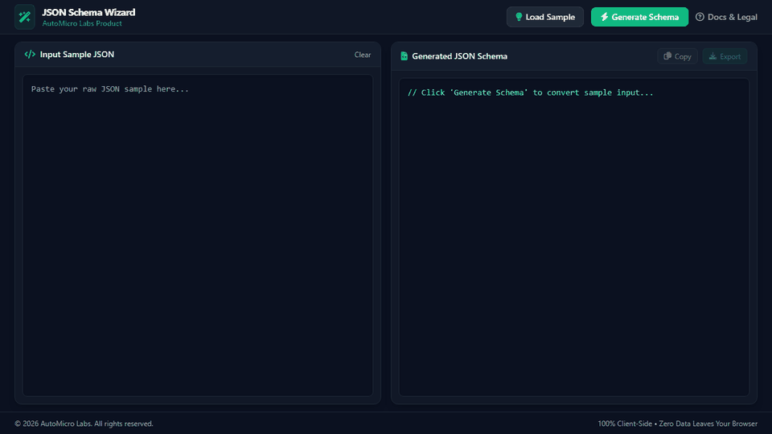

# JSON Schema Wizard

**JSON Schema Wizard** is a high-performance developer tool designed to instantly generate robust, validated JSON schemas from raw sample data payloads. Built for backend engineers, API developers, and QA automation teams.

## 🚀 Key Features

- **Instant Generation:** Convert complex, deeply nested JSON samples into clean schemas in milliseconds.
- **Privacy First:** 100% client-side architecture. Your sensitive payloads never touch an external server.
- **Smart Inference:** Automatically detects data types, required fields, arrays, and object structures.

## 🔗 Quick Links

- **[Try the Free Live Demo](https://nexusmedialab04-art.github.io/json-schema-wizard/)**
- **[Get the Full Offline Pro Edition](https://bobservice.gumroad.com/l/json-schema-wizard?utm_source=github)**

---

## 📊 Feature Matrix: Free Lite Edition vs Full Pro Edition

| Feature | Free Lite Edition | Full Pro Edition |
| :--- | :---: | :---: |
| Client-Side Processing | ✅ | ✅ |
| Basic Type Inference | ✅ | ✅ |
| Advanced Nested Schema Generation | ❌ | ✅ |
| Full Offline Capabilities | ❌ | ✅ |
| Priority Updates & Support | ❌ | ✅ |

Upgrade your workflow with the **[Full Pro Edition](https://bobservice.gumroad.com/l/json-schema-wizard?utm_source=github)** for offline usage and advanced enterprise features.

## 📄 License

Distributed under the MIT License. See `LICENSE` for details.