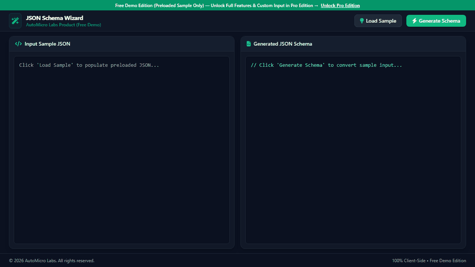

# JSON Schema Wizard

**Instantly generate robust JSON schemas from raw sample data for your APIs.**

100% client-side browser utility. Paste your raw JSON payload and infer clean JSON Schema specifications locally without sending sensitive API payloads to external servers.

- **[Try the Free Live Demo (GitHub Pages)](https://nexusmedialab04-art.github.io/json-schema-wizard/)**
- **[Get the Full Offline Pro Edition on Gumroad](https://gumroad.com)**

---

## Full Pro Edition Preview

---

## Free Live Demo Preview

---

## Free Live Demo vs. Full Pro Edition

| Feature | Free Live Demo (GitHub Pages) | Full Pro Edition (Gumroad) |
| :--- | :---: | :---: |
| **Client-Side Architecture (Zero Backend)** | Yes | Yes |
| **Preloaded Sample Data (`Load Sample`)** | Yes | Yes |
| **Custom JSON Input & Editing** | Preloaded Sample Only | Unlimited Custom JSON |
| **Schema Inference Depth** | Partial Preview (Top-Level Sample) | Full Recursive Nested Schema |
| **Executions per Session** | Up to 2 Sample Runs | Unlimited Runs |
| **One-Click Copy & `.json` File Export** | — | Included |
| **Built-In Documentation & Legal Guide** | — | Included |
| **Offline Single-File Bundle (`index.html`)** | — | Included |

---

## Quick Start

### Option 1: Test Online (Free Demo)
Open the **[Free Live Demo](https://nexusmedialab04-art.github.io/json-schema-wizard/)** in your browser, click **Load Sample**, and click **Generate Schema** to inspect the inference engine.

### Option 2: Run Offline with Your Own Payloads (Pro Edition)
1. Download the single-file bundle from **[Gumroad](https://gumroad.com)**.
2. Extract the archive and double-click `index.html` in any modern browser.
3. Paste any raw API payload, generate the full JSON Schema, and copy or export it immediately.

---

## Privacy & Architecture

- **Zero Data Transmission:** All parsing and type inference execute strictly inside your browser's local memory.
- **No Tracking or Accounts:** Works completely offline without external APIs or telemetry.
